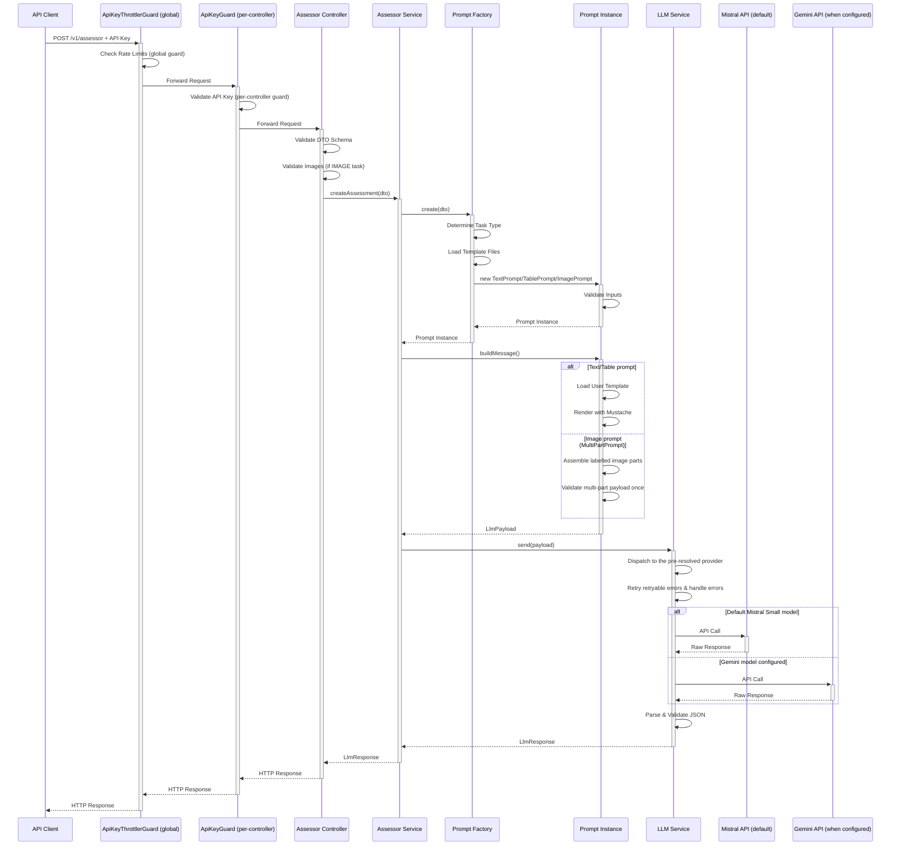

# Data Flow

Request/response flow from HTTP request to LLM response.

## Flow Steps

### 1. Request Entry

`POST /v1/assessor` — received by NestJS, processed through middleware with logging and data redaction.

### 2. Security Layer

- **Rate Limiting**: The global `ApiKeyThrottlerGuard` enforces per-time-window limits; returns 429 if exceeded. As a global guard, it runs before per-controller guards.
- **Authentication**: `ApiKeyGuard` validates the Bearer token from the `Authorization` header; rejects with 401 if invalid.

### 3. Controller Layer

`AssessorController` validates the request body via `ZodValidationPipe` against `assessorDtoSchema`, performing task-type-specific checks (e.g. image format and size for `IMAGE` tasks).

### 4. Service Layer

`AssessorService.createAssessment()` orchestrates the workflow: delegates prompt creation to `PromptFactory`, triggers message building, and sends the payload to the LLM.

### 5. Prompt Generation

`PromptFactory` instantiates the correct prompt type (Text, Table, or Image) based on task type. Text and table prompts validate inputs, load Markdown templates, and render them with Mustache using assessment variables (`{{referenceTask}}`, `{{studentTask}}`, `{{emptyTask}}`). For IMAGE tasks the factory passes the validated data-URI strings to `ImagePrompt`, which extends `MultiPartPrompt` to assemble a two-message conversation of ordered label-image parts, derive its cache key server-side, and validate the payload once.

### 6. LLM Integration

`RoutingLLMService` resolves the task-specific providers and models once in its constructor from server-side configuration, then dispatches at send time. Both model settings default to `mistral-small-latest`, so the default path calls the Mistral API via `MistralService`; a configured Gemini model instead uses `GeminiService`. The selected provider retries retryable errors with exponential backoff (up to `LLM_MAX_RETRIES` times), parses the response JSON (repairing with `jsonrepair` if needed), and validates against `LlmResponseSchema`.

### 7. Response Delivery

Validated `LlmResponse` is returned as HTTP 200 JSON. Failures map to an HTTP error response; see [LLM Error Handling](../llm/error-handling.md) and [Error Codes](../api/error-codes.md) for the full rules and wire format.

---

_For architectural context, see [Architecture Overview](overview.md) and [Module Responsibilities](modules.md)._
