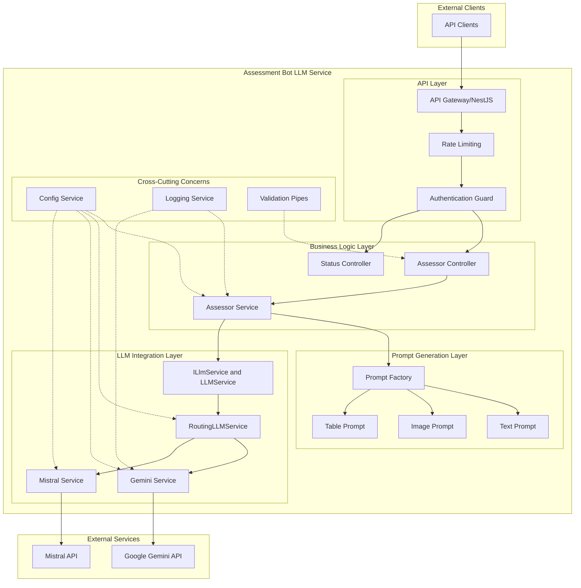

# Architecture Overview

High-level architecture of the Assessment Bot LLM Service, a NestJS-based API that uses LLMs for automated educational assessment.

## High-Level Architecture

### Key Components

| Component                    | Responsibility                                           |
| ---------------------------- | -------------------------------------------------------- |
| **Authentication Guard**     | API key validation via Bearer tokens                     |
| **Rate Limiting**            | Request throttling for abuse prevention                  |
| **Assessor Service**         | Core business logic orchestration                        |
| **Prompt Factory**           | Task-specific prompt generation (Factory pattern)        |
| **ILlmService / LLMService** | Provider contract and abstract base (Strategy pattern)   |
| **RoutingLLMService**        | Dispatches to the configured provider and model per task |
| **Gemini Service**           | Google Gemini API integration                            |
| **Mistral Service**          | Mistral API integration                                  |
| **Config Service**           | Zod-validated environment configuration                  |

## External Dependencies

- **Mistral API**: Default provider for content assessment using `mistral-small-latest`.
- **Google Gemini API**: Supported when a Gemini model is selected in configuration.

Module composition and dependencies are described in [Module Responsibilities](modules.md).

## Technology Stack

- **Runtime**: Node.js — see the [production](../../Docker/Dockerfile.prod) and [development](../../Docker/Dockerfile) Dockerfiles
- **Framework**: NestJS with Express.js, TypeScript
- **Validation**: Zod schemas for all runtime validation
- **Auth**: Passport.js with `passport-http-bearer` strategy
- **LLM Integration**: Abstract `LLMService` base class, `RoutingLLMService`, Mistral and Gemini provider implementations, and `jsonrepair` for response parsing
- **Templating**: Mustache for prompt rendering
- **Testing**: Vitest, Supertest
- **Logging**: `nestjs-pino` with structured JSON output
- **Rate Limiting**: `@nestjs/throttler`

### Environment Differences

The production and development images are defined by the [production Dockerfile](../../Docker/Dockerfile.prod), the [development Dockerfile](../../Docker/Dockerfile) and the [dev container configuration](../../.devcontainer/devcontainer.json). Verify production builds against the production image before release.

---

_For class relationships, see the [Class Structure](../design/ClassStructure.md) diagram._
