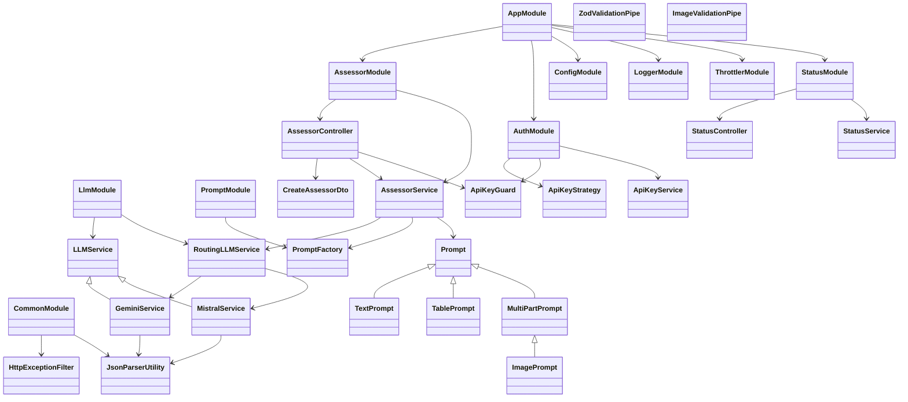

# Class Structure

The diagram shows the main classes and how they relate. An arrow with a hollow triangle (`<|--`) means inheritance: the class on the left is a base of the class on the right. A plain arrow (`-->`) means the class on the left uses or composes the class on the right; module arrows show composition by import.

